# Ask My Docs

A document question-answering API built with retrieval-augmented generation (RAG). It indexes PDF and Markdown files, retrieves relevant passages from Chroma, and asks a local Ollama model to answer from those passages with citations.

## Architecture

```mermaid
flowchart LR
    files[PDF and Markdown files] --> loader[Document loader]
    loader --> chunker[Token chunker]
    chunker --> embed[Sentence Transformers]
    embed --> chroma[(Chroma vector store)]
    question[POST /ask] --> query[Embed question]
    query --> vector[Vector search]
    chroma --> vector
    query --> bm25[BM25 keyword search]
    bm25 --> fusion[RRF fusion]
    vector --> fusion
    fusion --> rerank[Optional CrossEncoder reranking]
    rerank --> context[Top context passages]
    context --> prompt[Grounded prompt]
    prompt --> ollama[Ollama]
    ollama --> answer[Answer and citations]
    answer --> evaluate[Golden evaluation]
    evaluate --> gate[Quality gate and CI]
```



## Requirements

- Python 3.11 or newer
- Ollama installed and running locally (or reachable at `OLLAMA_BASE_URL`)
- A model available in Ollama; the default is configured by `OLLAMA_MODEL`

## Setup

Create and activate a virtual environment, then install the project dependencies.

```powershell
python -m venv .venv
.\.venv\Scripts\Activate.ps1
python -m pip install --upgrade pip
python -m pip install -r requirements.txt
```

On macOS or Linux, activate it with `source .venv/bin/activate`.

Copy `.env.example` to `.env` and adjust settings there. The application creates the configured document and Chroma directories at startup. Start Ollama separately and make sure the model named in `OLLAMA_MODEL` is available locally.

The default embedding model is downloaded by `sentence-transformers` the first time ingestion or retrieval loads it. The Ollama model is managed by Ollama, separately from Python dependencies.

## Run the application

Place PDFs and Markdown files in `data/docs/`, then ingest them:

```powershell
python ingest_cli.py
```

You can choose another source directory with `python ingest_cli.py --docs-dir path/to/docs`.

Start the API:

```powershell
python -m app.main
```

The server reads `HOST`, `PORT`, and `APP_ENV` from `.env`. With the defaults, the interactive API docs are at `http://localhost:8000/docs`. `GET /health` reports the indexed chunk count and active model settings. `POST /ingest` runs ingestion through the API. `POST /ask` accepts a question and an optional `top_k` override:

```json
{
  "question": "What does the document say about retrieval?",
  "top_k": 4
}
```

The response includes an answer, citations with source/page/chunk ID/snippet, retrieval mode, and retrieval, reranking, generation, and total latency in milliseconds.

## Configuration

Application settings are defined in `app/config.py` and can be overridden with environment variables in `.env`. Important settings include:

| Setting | Default | Purpose |
| --- | --- | --- |
| `DOCS_DIR` | `data/docs` | Source PDF and Markdown files |
| `CHROMA_PERSIST_DIR` | `data/chroma_db` | Persistent vector-store files |
| `CHROMA_COLLECTION_NAME` | `ask_my_docs` | Chroma collection |
| `CHUNK_SIZE_TOKENS` | `600` | Maximum chunk size |
| `CHUNK_OVERLAP_TOKENS` | `90` | Token overlap between chunks |
| `EMBEDDING_MODEL_NAME` | `BAAI/bge-small-en-v1.5` | Sentence Transformers embedding model |
| `TOP_K` | `4` | Number of passages retrieved for an answer |
| `RETRIEVAL_MODE` | `vector_only` | `vector_only`, `hybrid`, or `hybrid_rerank` |
| `RETRIEVAL_CANDIDATE_K` | `20` | Candidates requested from each search channel |
| `RRF_K` | `60` | Rank constant used by Reciprocal Rank Fusion |
| `RERANKER_MODEL_NAME` | `cross-encoder/ms-marco-MiniLM-L6-v2` | CrossEncoder model for `hybrid_rerank` |
| `BM25_INDEX_DIR` | `data/bm25_index` | Persistent lexical-index cache |
| `QUERY_CACHE_SIZE` | `128` | Maximum cached normalized queries; `0` disables caching |
| `QUERY_CACHE_TTL_SECONDS` | `300` | Cache lifetime in seconds; `0` disables caching |
| `EVAL_GOLDEN_PATH` | `eval/golden.jsonl` | Reviewed question/answer/source dataset |
| `EVAL_RESULTS_DIR` | `eval` | JSON and Markdown evaluation reports |
| `EVAL_CANDIDATE_COUNT` | `50` | Default number of draft question/answer pairs |
| `EVAL_MIN_*` | `0.30` or `0.50` | Minimum metric values enforced by the quality gate |
| `OLLAMA_BASE_URL` | `http://localhost:11434` | Ollama server URL |
| `OLLAMA_MODEL` | `llama3.2` | Model tag available in Ollama |
| `LLM_TIMEOUT_SECONDS` | `60` | Maximum wait for Ollama |

### Retrieval modes

- `vector_only` searches Chroma using embedding similarity.
- `hybrid` retrieves vector and BM25 candidates, merges their rankings with Reciprocal Rank Fusion (RRF), and returns the top `TOP_K` passages.
- `hybrid_rerank` does the same fusion, then scores up to `RETRIEVAL_CANDIDATE_K` passages with the configured CrossEncoder and sends the top `TOP_K` to Ollama.

The BM25 scoring statistics are saved as JSON in `BM25_INDEX_DIR`; the cache is refreshed after API ingestion and reused on startup when its content signature matches Chroma. The CrossEncoder is loaded only when a `hybrid_rerank` query first needs it. Both models are separate from Ollama and may download from Hugging Face on first use.

Repeated normalized questions are kept in a bounded in-memory cache for the configured time-to-live. A cache hit reuses the complete answer without another retrieval or Ollama call. `POST /ingest` clears the cache and refreshes BM25. If you ingest with the CLI while the API remains running, restart the API so its in-memory state reloads from Chroma.

## Design notes and current limits

- Chunk IDs are deterministic, so re-ingesting the same content updates existing Chroma records instead of duplicating them.
- Chroma is behind the `VectorStore` interface, keeping storage replaceable.
- The LLM is behind an interface for testability, while this project configuration uses Ollama only.
- Prompts instruct the model to use retrieved context only, cite claims, and acknowledge missing evidence.
- PDF text extraction does not OCR scanned pages. Image-only PDFs need an OCR step before they can be searched.
- BM25, RRF, reranking, and query caching are optional and controlled by the retrieval settings.

## Tests and developer commands

```powershell
python -m pytest tests/ -v
```

The Makefile also provides `make ingest`, `make serve`, and `make test` for environments with Make installed.

## Evaluation (Phase 3)

`eval/golden.jsonl` is the reviewed evaluation set. It starts with ten questions based on the RAM-UR paper test document and uses this shape, one JSON object per line:

```json
{"question":"What does Regularity state?","ground_truth_answer":"...","ground_truth_sources":[{"source":"testfile.pdf","pages":[10]}]}
```

The source filename and page list are used for retrieval recall and MRR. Keep the source pages accurate when editing the golden set. `make eval` (or `python -m eval.run`) runs each question through `vector_only`, `hybrid`, and `hybrid_rerank`, asks Ollama to answer, then uses Ragas to score faithfulness, answer relevancy, context precision, and context recall. It also computes retrieval recall@k and MRR. The local Ollama model is used as the Ragas evaluator, and the local Sentence Transformers embedding model is used for embedding-based evaluation. No cloud LLM API key is required. Ragas' supported evaluator integrations include local Ollama models. ([Ragas local-model setup](https://docs.ragas.io/en/stable/getstarted/evals/))

The evaluation writes `eval/results.json` and `eval/results.md`. Review the scores and per-question retrieval sources before treating a mode as better; LLM-judged metrics are estimates, not proof of correctness. Run the command after the source documents have been ingested and Ollama is running:

```powershell
python -m eval.run
python -m eval.quality_gate
```

The quality gate compares every mode against the `EVAL_MIN_*` thresholds in `.env.example` / `app/config.py` and exits nonzero if any score is too low. Tune these thresholds after establishing a baseline for your own document set.

To draft additional Q&A candidates from indexed chunks, run:

```powershell
python -m eval.generate_candidates --count 50
```

This writes `eval/candidates.jsonl`. Those are **drafts**: review the questions, answers, and source pages manually before copying accepted entries into `eval/golden.jsonl`.

GitHub Actions runs unit tests plus a small three-question smoke evaluation on a checked-in fixture using a small local Ollama model. It uploads the evaluation reports as workflow artifacts. The full ten-question evaluation remains available locally through `make eval`.

## Docker

Docker Compose runs the API and Ollama as separate containers, with persistent volumes for Ollama models, Chroma, and BM25. Put your PDFs or Markdown files in `data/docs/` first:

```powershell
docker compose up -d ollama
docker compose exec ollama ollama pull llama3.2
docker compose up --build -d app
docker compose exec app python ingest_cli.py
```

The API is then available at `http://localhost:8000/docs`. Change the model pull command if `OLLAMA_MODEL` in your `.env` uses a different tag. The compose service routes requests to Ollama through the internal Docker network.
