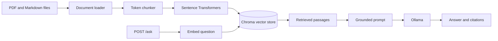

# Ask My Docs

A document question-answering API built with retrieval-augmented generation (RAG). It indexes PDF and Markdown files, retrieves relevant passages from Chroma, and asks a local Ollama model to answer from those passages with citations.

## Architecture



## Requirements

- Python 3.11 or newer
- Ollama installed and running locally (or reachable at `OLLAMA_BASE_URL`)
- A model available in Ollama; the default is configured by `OLLAMA_MODEL`

## Setup

Create and activate a virtual environment, then install the project dependencies.

```powershell
python -m venv .venv
.\.venv\Scripts\Activate.ps1
python -m pip install --upgrade pip
python -m pip install -r requirements.txt
```

On macOS or Linux, activate it with `source .venv/bin/activate`.

Copy `.env.example` to `.env` and adjust settings there. The application creates the configured document and Chroma directories at startup. Start Ollama separately and make sure the model named in `OLLAMA_MODEL` is available locally.

The default embedding model is downloaded by `sentence-transformers` the first time ingestion or retrieval loads it. The Ollama model is managed by Ollama, separately from Python dependencies.

## Run the application

Place PDFs and Markdown files in `data/docs/`, then ingest them:

```powershell
python ingest_cli.py
```

You can choose another source directory with `python ingest_cli.py --docs-dir path/to/docs`.

Start the API:

```powershell
python -m app.main
```

The server reads `HOST`, `PORT`, and `APP_ENV` from `.env`. With the defaults, the interactive API docs are at `http://localhost:8000/docs`. `GET /health` reports the indexed chunk count and active model settings. `POST /ingest` runs ingestion through the API. `POST /ask` accepts a question and an optional `top_k` override:

```json
{
  "question": "What does the document say about retrieval?",
  "top_k": 4
}
```

The response includes an answer, citations with source/page/chunk ID/snippet, retrieval mode, and retrieval, generation, and total latency in milliseconds.

## Configuration

Application settings are defined in `app/config.py` and can be overridden with environment variables in `.env`. Important settings include:

| Setting | Default | Purpose |
| --- | --- | --- |
| `DOCS_DIR` | `data/docs` | Source PDF and Markdown files |
| `CHROMA_PERSIST_DIR` | `data/chroma_db` | Persistent vector-store files |
| `CHROMA_COLLECTION_NAME` | `ask_my_docs` | Chroma collection |
| `CHUNK_SIZE_TOKENS` | `600` | Maximum chunk size |
| `CHUNK_OVERLAP_TOKENS` | `90` | Token overlap between chunks |
| `EMBEDDING_MODEL_NAME` | `BAAI/bge-small-en-v1.5` | Sentence Transformers embedding model |
| `TOP_K` | `4` | Number of passages retrieved for an answer |
| `OLLAMA_BASE_URL` | `http://localhost:11434` | Ollama server URL |
| `OLLAMA_MODEL` | `llama3.2` | Model tag available in Ollama |
| `LLM_TIMEOUT_SECONDS` | `60` | Maximum wait for Ollama |

Phase 1 supports vector-only retrieval. Hybrid retrieval and reranking are planned for Phase 2.

## Design notes and current limits

- Chunk IDs are deterministic, so re-ingesting the same content updates existing Chroma records instead of duplicating them.
- Chroma is behind the `VectorStore` interface, keeping storage replaceable.
- The LLM is behind an interface for testability, while this project configuration uses Ollama only.
- Prompts instruct the model to use retrieved context only, cite claims, and acknowledge missing evidence.
- PDF text extraction does not OCR scanned pages. Image-only PDFs need an OCR step before they can be searched.
- The current retrieval mode is vector-only; BM25, RRF, cross-encoder reranking, and query caching belong to Phase 2.

## Tests and developer commands

```powershell
python -m pytest tests/ -v
```

The Makefile also provides `make ingest`, `make serve`, and `make test` for environments with Make installed.
